# Magical Athlete

[Magical Athlete](https://www.cmyk.games/products/magical-athlete) is a racing game of dice and
nonsense, designed by Richard Garfield. Thirty-six ridiculous racers each have one power that
bends the rules: a Banana that trips anyone who passes it, a Huge Baby nobody can stand next to, a
M.O.U.T.H. that eats the competition, and a Scoocher that shuffles forward one space every time
anything else happens. You draft a team of four and race them one at a time, and the fun is in
the chain reactions.

This repo is a simulator of the game. It plays millions of races and games by the rules, so it can
answer the questions that come up at the table: who's actually good, which race to save your
best racer for, whether going first matters, and what happens when Scoocher and Suckerfish get
together (nothing good).

The answers come from the model, not from real tables. It follows the August 2026 printing of the
rulebook and the official rulings from the game's designers, and agrees with what players report
and with another simulator (see "Against real play"), but it hasn't been checked against logged
real games yet.

The simulator and this analysis were written with Claude Opus 5.5 at medium effort, working in
Claude Code throughout.

## The game in two minutes

**Racers and powers.** Every racer has a card with a power, a bit of flavor text, and notes for
the fiddly cases. Some powers are mandatory and go off on their own, like Banana's. Others are
optional, worded "I can…", and the player decides each time, like Legs ("Has arms, too, but who
cares"), who can skip rolling and just move 5.

**A turn.** On your turn you roll a die and move that many spaces. That's your *main move*, and
many powers care about it specifically, as opposed to other ways of moving. Racers can also:

- *pass* each other, which triggers powers like Banana's and Centaur's;
- *trip*, which means skipping your next main move;
- *warp*, which means being picked up and put somewhere without moving, as when Flip Flop swaps
  places with another racer.

**Tracks.** The board has two sides, both 30 spaces long:

- The **Mild Mile** is a plain track.
- The **Wild Wilds** adds three kinds of space:
  - *Stars* on spaces 1 and 13 give a bronze point chip to any racer that stops there.
  - *Arrows* push a racer forward or back. The one on 16 sends racers back 4, to 12.
  - *Trip spaces* trip whoever stops on them.

**A race** ends as soon as two racers cross the finish line. First across takes the gold chip and
second takes silver; everyone else gets nothing for placing. Bronze chips come from stars and
from powers like Lovable Loser's, who collects one at the start of each turn she's alone in last
place.

**A game** is four races, alternating Mild Mile, Wild Wilds, Mild Mile, Wild Wilds. The chips go
up as the game goes on:

| race | track | gold | silver |
| --- | --- | --- | --- |
| 1 | Mild Mile | 3 | 2 |
| 2 | Wild Wilds | 4 | 3 |
| 3 | Mild Mile | 4 | 3 |
| 4 | Wild Wilds | 5 | 4 |

Before the first race, everyone drafts four racers, one for each race. Twice as many racer cards
as players are flipped up, and everyone picks in a *snake draft*: around the table and back again,
so the last player picks twice in a row. A second snake draft, starting one seat to the left,
fills out the teams. Before each race, everyone secretly chooses which of their racers to send. Each
racer runs only once, so a big part of the game is deciding who to save for later.

## How to read the numbers

**Points per race** is the measure throughout: the average points a racer brings home from one
race, counting gold, silver and bronze. Winning isn't everything. A racer that never wins but
always picks up a few bronze chips can outscore one that wins a fifth of the time.

**A fair share** is what an average racer would get if the gold and silver were split evenly:
(gold + silver) ÷ players. In race 1 with 5 players that's (3 + 2) ÷ 5 = 1.00. A racer at 2 fair
shares is twice as good as average.

**Most tables come from one big dataset:** a million races with random lineups for each track and
each table size from 3 to 6 players. Races 1 and 3 are both on the Mild Mile and differ only in
chip values, so they're scored from the same races, and so are races 2 and 4.

**Noise.** These are averages over random races, so small differences can be luck. Each table
says roughly how big a difference has to be before it means something.

**Optional powers** are played by hand-written rules of thumb ("Legs moves 5 when that lands
somewhere better than an average roll"), each tuned to be about as good as we could find (see
"Playing your racer well").

The raw data behind every table and chart is on Hugging Face as Parquet files, a row per racer per
race or per player per game:
[visnup/magical-athlete](https://huggingface.co/datasets/visnup/magical-athlete). `make`
regenerates it into `results/` and redraws `charts/`, and each section names the script behind
it. The tables below are from 2026-11-03.

## Who's good

*From `node scripts/points.ts --race k`, a million races of 5 players.*

The best and worst five-ish racers in race 1, on the Mild Mile, where a fair share is 1.00:

| racer | points | 1st | 2nd | bronze |
| --- | --- | --- | --- | --- |
| Lovable Loser | 3.03 | 3.6% | 8.0% | 2.76 |
| Sisyphus | 2.92 | 0.3% | 1.2% | 2.89 |
| Scoocher | 2.37 | 65.3% | 20.7% | 0 |
| Romantic | 2.03 | 53.5% | 21.2% | 0 |
| Egg | 1.65 | 25.5% | 20.8% | 0.47 |
| Suckerfish | 1.61 | 30.3% | 34.8% | 0 |
| Dicemonger | 1.47 | 32.5% | 24.5% | 0 |
| … | | | | |
| Banana | 0.66 | 10.8% | 17.0% | 0 |
| Alchemist | 0.61 | 9.5% | 16.3% | 0 |
| Blimp | 0.51 | 9.2% | 11.6% | 0 |
| Centaur | 0.48 | 7.7% | 12.7% | 0 |
| Huge Baby | 0.44 | 6.8% | 12.0% | 0 |

And race 2, on the Wild Wilds, where a fair share is 1.40:

| racer | points | 1st | 2nd | bronze |
| --- | --- | --- | --- | --- |
| Scoocher | 7.66 | 48.4% | 21.8% | 5.07 |
| Dicemonger | 4.02 | 28.7% | 20.4% | 2.26 |
| Suckerfish | 3.96 | 30.6% | 33.7% | 1.72 |
| Flip Flop | 3.75 | 34.6% | 24.0% | 1.65 |
| Sisyphus | 3.73 | 0.5% | 1.8% | 3.66 |
| Lovable Loser | 3.71 | 4.5% | 8.9% | 3.27 |
| … | | | | |
| Banana | 1.46 | 9.1% | 14.8% | 0.65 |
| Alchemist | 1.41 | 8.8% | 14.9% | 0.61 |
| Centaur | 1.32 | 7.7% | 13.0% | 0.63 |
| Coach | 1.28 | 10.8% | 16.2% | 0.36 |
| Blimp | 1.11 | 11.0% | 12.8% | 0.29 |

**The top of race 1 is two racers who almost never place.** Lovable Loser ("Top of her class at
Loser Academy. Which is bad.") takes a bronze chip every turn she starts alone in last. Sisyphus
starts the race with 4 chips and loses one for every 6 it rolls, which also warps it back to
the Start. Each walks away with nearly 3 points whatever happens, while gold in race 1 is only
worth 3.

**Scoocher wins two Mild Mile races in three.** Its power, "When another racer's power happens, I
move 1", sounds modest, but with five racers' powers going off, that's about 18 extra spaces a
race. That rests on a ruling: Garfield's rule of thumb is that anything that changes the board,
compared with a racer with no power, counts as a power happening, and that includes passive
powers like Gunk's −1 to everyone's main move, every turn. On the Wild Wilds, Scoocher's
one-space shuffles keep landing it on stars, and it more than triples a fair share.

**Romantic** moves 2 whenever a racer stops on a space with exactly one other, which happens
constantly while everyone's bunched up early.

**Dicemonger is second on the Wild Wilds.** Its power lets every racer reroll their main move once
a turn, and Dicemonger moves 1 each time someone else does. On a track full of stars, arrows and
trip spaces, racers reroll far more often, and each reroll carries Dicemonger another space.

**At the bottom** are Blimp ("Built to fly, born to explode"; +3 before the second corner, −1
after), Centaur, who knocks back racers it passes by 2, and Huge Baby.

The chance of each score in a race of 6, strongest racers first, with each racer's likeliest score
labeled:

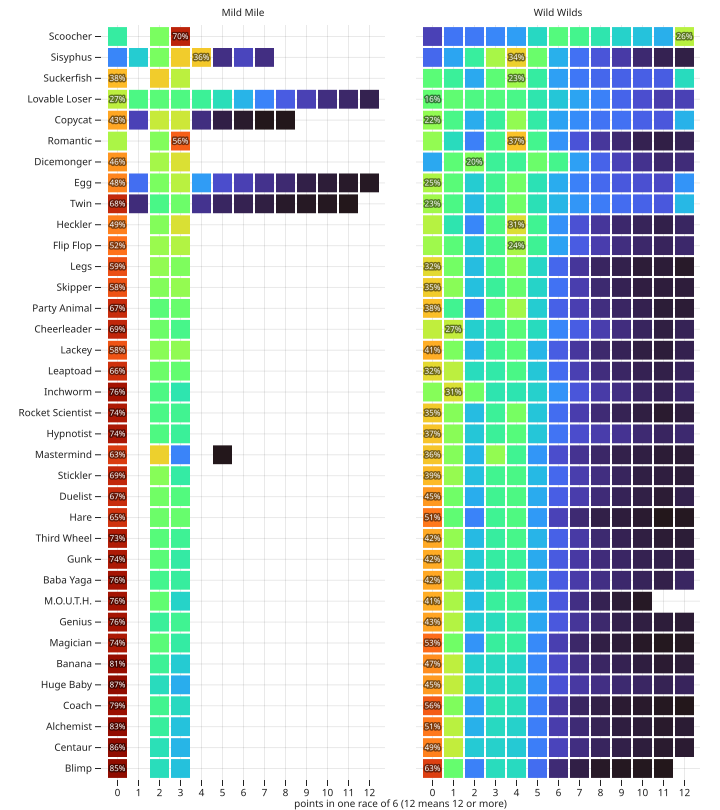

And their chances of 1st and 2nd:

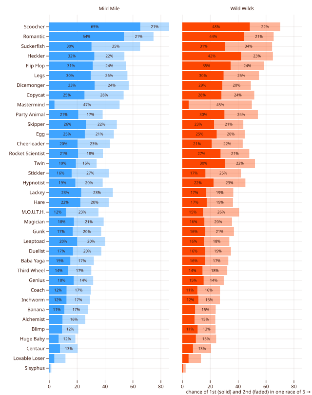

Twin, who copies the power of an earlier race's winner, is averaged here over both races on each
track. That's 0 or 2 earlier winners to choose from on the Mild Mile, and 1 or 3 on the Wild
Wilds. "Racers that pick racers" takes each race on its own.

## How many players

*From `node scripts/players.ts`.* Points per race as a multiple of a fair share, so different
table sizes compare directly; selected racers:

| racer | Mild 3p | 4p | 5p | 6p | Wild 3p | 4p | 5p | 6p |
| --- | --- | --- | --- | --- | --- | --- | --- | --- |
| Lovable Loser | 3.29 | 3.17 | 3.03 | 2.83 | 2.83 | 2.73 | 2.65 | 2.57 |
| Sisyphus | 1.66 | 2.28 | 2.92 | 3.59 | 1.57 | 2.11 | 2.67 | 3.24 |
| Scoocher | 1.24 | 1.76 | 2.37 | 2.97 | 1.93 | 3.31 | 5.47 | 8.45 |
| Romantic | 1.14 | 1.55 | 2.03 | 2.50 | 1.26 | 1.63 | 2.08 | 2.55 |
| Flip Flop | 1.25 | 1.35 | 1.41 | 1.46 | 1.83 | 2.29 | 2.68 | 3.06 |
| Legs | 1.46 | 1.53 | 1.42 | 1.22 | 1.58 | 1.77 | 1.80 | 1.78 |
| Stickler | 1.21 | 1.15 | 1.02 | 0.85 | 1.42 | 1.48 | 1.47 | 1.44 |
| Cheerleader | 1.26 | 1.23 | 1.08 | 0.88 | 1.50 | 1.66 | 1.73 | 1.81 |
| Hypnotist | 1.22 | 1.14 | 0.95 | 0.75 | 1.59 | 1.72 | 1.71 | 1.63 |
| M.O.U.T.H. | 1.17 | 1.06 | 0.83 | 0.61 | 1.46 | 1.50 | 1.40 | 1.28 |
| Alchemist | 0.99 | 0.80 | 0.61 | 0.48 | 1.15 | 1.07 | 1.01 | 0.99 |
| Third Wheel | 0.69 | 0.68 | 0.74 | 0.79 | 0.97 | 1.06 | 1.22 | 1.38 |


**Scoocher is a monster at big tables and merely good at small ones.** At 3 players it earns 1.24
fair shares on the Mild Mile, behind Lovable Loser, Sisyphus, Legs, Egg and Flip Flop. Every extra
racer is another power for it to feed on, so by 6 players it's at 3 fair shares on the Mild Mile
and over 8 on the Wild Wilds. Racers that feed on traffic all climb with the count: Romantic,
Suckerfish, Dicemonger, Copycat, and Heckler, who moves 2 whenever a racer ends a turn within a
space of where it started.

**Bronze racers look better at big tables partly by arithmetic.** Sisyphus's 4 chips are worth
the same at any table size, while a fair share of gold and silver shrinks, so its multiple doubles
from 3 to 6 players. Lovable Loser slips slightly instead: being alone in last is harder in a
crowd.

**Some racers like it quiet.** Alchemist, Banana, M.O.U.T.H., Hypnotist, Coach, Magician, Gunk and
Stickler all lose ground on the Mild Mile as the table grows; Alchemist halves (0.99 to 0.48).

**At 3 players the field flattens.** Most racers sit between 0.8 and 1.3 fair shares. Only Lovable
Loser stands out, and Third Wheel, Huge Baby and Blimp trail.

## Who's good with whom

*From `node scripts/matchups.ts`*, which compares each racer's points in races with another
particular racer against races without, from the million 5-player races per track. Each pair
meets in about 16,000 races, so differences under about 0.05 (Mild Mile) or 0.1 (Wild Wilds) are
noise. Selected effects, in race-1 or race-2 points:

| racer | with | Mild Mile | Wild Wilds |
| --- | --- | --- | --- |
| Suckerfish | Scoocher | +0.05 | +6.66 (3.21 → 9.87) |
| Scoocher | Suckerfish | +0.08 | +5.37 (7.05 → 12.41) |
| Copycat | Scoocher | +0.54 | +5.23 (2.77 → 8.00) |
| Scoocher | Gunk | +0.54 | +3.47 |
| Baba Yaga | Hypnotist | +1.13 (0.66 → 1.79) | +1.66 |
| Copycat | Hypnotist | +0.98 (1.24 → 2.22) | +1.32 |
| Heckler | Gunk | +0.77 | +0.75 |
| Huge Baby | M.O.U.T.H. | +0.72 (0.36 → 1.08) | +0.97 |
| Lovable Loser | Gunk | +0.76 | +0.75 |
| Copycat | Flip Flop | −0.30 (1.38 → 1.08) | +0.47 |
| Lovable Loser | Sisyphus | −1.41 (3.19 → 1.79) | −1.26 |
| Scoocher | M.O.U.T.H. | −0.58 | −2.99 (7.99 → 5.00) |
| Dicemonger | Scoocher | −0.84 (1.56 → 0.72) | −1.11 |
| Legs | Dicemonger | −0.67 | −0.59 |

Every pair, as the row racer's points minus the column racer's when both are in a race of 6:

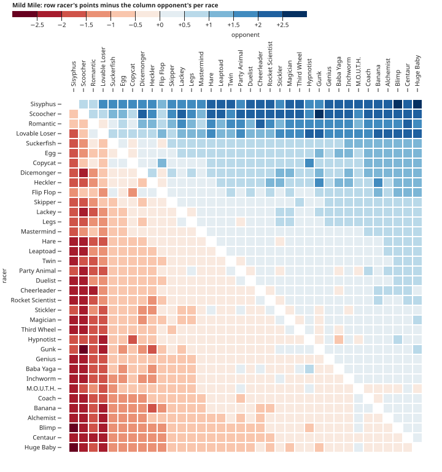


**Scoocher and Suckerfish are the game's most broken pair.** Suckerfish ("Has abandonment issues")
can ride along whenever a racer leaves its space. When the two share a space, Scoocher moves,
Suckerfish rides with it, which is a power, so Scoocher moves again, and so on all the way across
the finish. The rulebook knows ("Some powers can interact many times but aren't a loop, like
Scoocher/Suckerfish"), so it's left as the rules make it. On the Wild Wilds they also ride each
other around and around the arrow loop from 16 back to 12, picking up the star on 13 every lap.

**Anything that adds powers feeds Scoocher.** Gunk's −1 every turn, Copycat, Romantic, Hypnotist
and Party Animal all add triggers. Copycat, who has the power of whoever's leading, often *is* a
second Scoocher. Racers whose powers rarely go off cost Scoocher over a point a race on the Wild
Wilds, just by taking a seat a busier racer would have had: Twin without a winner to copy, Third
Wheel, Rocket Scientist, Alchemist, Mastermind.

**M.O.U.T.H. is the counter to Scoocher.** M.O.U.T.H. ("Mastication Orifice Utilized Toward
Hunger") eliminates any racer it stops alone with. Scoocher creeps forward a space at a time and
keeps ending up next to other racers, which is exactly what M.O.U.T.H. eats. It also counters
Hypnotist and Party Animal, who pull racers onto shared spaces.

**Hypnotist's two exceptions win the most from it.** Hypnotist warps a racer back to its own space
at the start of each turn. The model pulls back any opponent ahead except Copycat and Baba Yaga,
to avoid loops (see "Rules findings"), so those two gain a point or more with Hypnotist in the
race: everyone else gets pulled back, they don't. Fits the data, not traced through individual
races.

**Flip Flop takes Copycat's lead.** Flip Flop can swap places with any racer instead of rolling.
It used to leave Copycat alone, and Copycat would copy Flip Flop and swap with the leader itself,
worth +0.66 a race to Copycat on both tracks. Now Flip Flop swaps with a Copycat ahead too, and
Copycat loses 0.30 with it on the Mild Mile and gains only 0.47 on the Wild Wilds.

**Lovable Loser and Sisyphus can't share a race.** Sisyphus keeps warping back to the Start, so
Lovable Loser is rarely alone in last; they also draw on the same bronze chips.

**Heckler likes anything that stalls racers.** Trips from Banana and Baba Yaga, and Gunk's −1, make
more racers end a turn within one space of where they started, which is Heckler's trigger.

**Dicemonger's rerolls help everyone else.** Each one also moves Scoocher, and rerolls help Legs's
and Skipper's opponents more than they help Legs and Skipper.

**Huge Baby ("She's 30") is safe from M.O.U.T.H.** Nobody can stop on Huge Baby's space, so
M.O.U.T.H. can't eat it, while it eats the racers bumped in behind her.

## Which race to play each racer in

*From `node scripts/lineup.ts`.* Each racer's points in each of the four races, from the dataset.
Twin is raced again with earlier winners drawn from the earlier races. A team's value is its best
assignment of four racers to four races. A racer's *draft value* is how much better the random
teams it's on do than the average team (9.30 points a game): how much picking it is worth.
`lineup.ts --write` saves these to `ratings.json` for the simulated players to draft and choose
by.

| racer | race 1 (Mild 3/2) | race 2 (Wild 4/3) | race 3 (Mild 4/3) | race 4 (Wild 5/4) | usually played in | draft value |
| --- | --- | --- | --- | --- | --- | --- |
| Scoocher | 2.37 | 7.66 | 3.23 | 8.36 | 4 | +4.67 |
| Twin | 0.28 | 2.96 | 2.10 | 4.86 | 4 (always) | +1.46 |
| Lovable Loser | 3.03 | 3.71 | 3.15 | 3.85 | 1 | +1.25 |
| Suckerfish | 1.61 | 3.96 | 2.26 | 4.60 | 4 | +1.24 |
| Dicemonger | 1.47 | 4.02 | 2.04 | 4.51 | 2 | +1.23 |
| Sisyphus | 2.92 | 3.73 | 2.94 | 3.76 | 1 | +1.14 |
| Flip Flop | 1.41 | 3.75 | 1.96 | 4.34 | 4 | +1.00 |
| Romantic | 2.03 | 2.91 | 2.78 | 3.57 | 3 | +0.72 |
| Copycat | 1.35 | 3.37 | 1.88 | 3.88 | 4 | +0.64 |
| Egg | 1.65 | 3.29 | 2.11 | 3.74 | 2 | +0.55 |
| Heckler | 1.40 | 2.89 | 1.94 | 3.54 | 4 | +0.29 |
| … | | | | | | |
| Huge Baby | 0.44 | 1.56 | 0.63 | 1.80 | 2 | −0.98 |
| Blimp | 0.51 | 1.11 | 0.72 | 1.35 | 1 | −1.05 |
| Centaur | 0.48 | 1.32 | 0.69 | 1.53 | 1 | −1.07 |

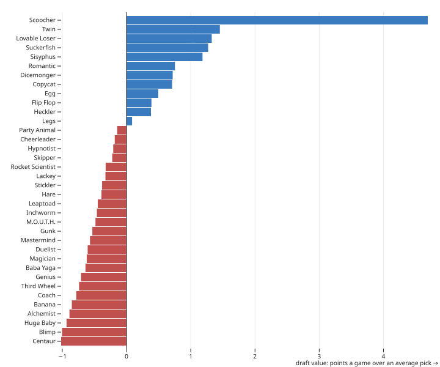

**The Wild Wilds races are worth more for everyone.** Stars add bronze, so race 2 out-earns race 3
even though their gold and silver are the same. Race 4 is the jackpot.

**Save Scoocher for race 4, and send the bronze racers out first.** Lovable Loser's and Sisyphus's
points barely change from race to race, so race 1, the cheapest, costs them the least.

**Some racers prefer the Mild Mile.** Romantic, Skipper, Lackey, Hare and Magician usually go to
race 3: they're about as good on either track, while everyone else gains more from the stars.
Inchworm, Huge Baby, Dicemonger, Egg and M.O.U.T.H. go to race 2 for the opposite reason.

**If you see Scoocher in the draft, take it.** It's worth about 4.7 points a game over an average
pick, three times the next racer. After it come Twin (saved for race 4), Lovable Loser,
Suckerfish, Dicemonger and Sisyphus, all within a quarter point of each other.

## Playing your racer well

*From `node scripts/choices.ts`*, which races each racer with an optional power in every race
(100,000 races of 5) and compares the rule of thumb it plays by now with alternatives. Points per
race, race 1 / race 2:

| racer | current choice | alternatives |
| --- | --- | --- |
| Alchemist | by where each option lands, a star worth 15 spaces: 0.63 / 1.45 | always move 4 (previous) +0.00 / −0.20, never 0.28 / 1.08 |
| Cheerleader | by where each option lands, two moves from last place, never for an opponent's M.O.U.T.H.: 1.10 / 2.50 | for M.O.U.T.H. too (previous) −0.01 / −0.03, not for M.O.U.T.H. only when it would eat +0.01 / −0.00, one move of 3 −0.01 / −0.09, always cheer −0.01 / −0.22, never 0.29 / 1.13 |
| Flip Flop | by where each swap lands, a star worth 15 spaces, Copycat included: 1.43 / 3.79 | never with a Copycat (previous) −0.01 / −0.09; a star worth 3 +0.00 / −0.81, 6 +0.00 / −0.54, 30 +0.00 / −0.02; farthest 4+ ahead −0.02 / −1.20, never 0.29 / 1.08 |
| Genius | predict 1 when leading, else 6: 0.82 / 1.71 | always 6 (previous) −0.03 / −0.03, 1 when in the top two −0.01 / −0.01; always 1 is worst (−0.27 / −0.28) |
| Hypnotist | any opponent ahead but Copycat and Baba Yaga: 0.97 / 2.44 | also Baba Yaga −0.02 / +0.04, 7+ ahead −0.32 / −0.56, never 0.28 / 1.06 |
| Legs | by where each option lands: 1.44 / 2.58 | a star worth 15 spaces +0.00 / −0.10, always move 5 (previous) −0.01 / −0.65, never 0.31 / 1.14 |
| Magician | reroll when the roll lands worse than an average roll, a star worth 15 spaces: 0.98 / 2.19 | 1–4 then 1–3 (previous) −0.04 / −0.62, a star worth 3 +0.00 / −0.04, 1–3 both times −0.08 / −0.68, 1–2 −0.25 / −0.79 |
| Mastermind | the likeliest winner on this track: 1.06 / 2.16 | the best-rated racer (previous) −0.22 / −0.27 |
| Rocket Scientist | by where each option lands, but not to within 6 of the finish without crossing: 1.00 / 2.34 | even just short of the finish (previous) −0.12 / −0.06, within 3 −0.04 / −0.01, within 9 −0.02 / −0.12, 4+ −0.14 / −0.29, always −0.36 / −0.98 |
| Suckerfish | ride, except another player's Scoocher near the finish: 1.61 / 3.85 | always ride +0.02 / −0.00, never 0.31 / 1.15 |
| Third Wheel | farthest pair ahead: 0.75 / 1.74 | nearest pair ahead −0.01 / −0.01, never 0.29 / 1.11 |

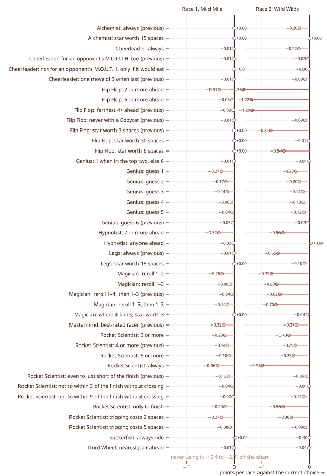

Every current choice is the best of what was tried, within noise (±0.01), with two exceptions.
Suckerfish gives up a few hundredths on purpose (see "More findings"). For Hypnotist, also pulling
back Baba Yaga is +0.04 on the Wild Wilds but −0.02 on the Mild Mile.

**Use your power.** Every optional power is worth a lot over ignoring it: never using it costs 0.4
to 2.7 points a race.

**On the Wild Wilds, look at where you'll land, not how far you'll go.** Legs can move 5 instead of
rolling, Alchemist can move 4 instead of a 1 or 2, and Rocket Scientist can double its roll and
trip. Each choice lands on a different space, and a star, an arrow or a trip space there matters
more than a space or two of distance. Choosing by where each option lands gained Legs 0.6 a race
on the Wild Wilds.

**A star is worth about 15 spaces.** A star is a sure point, while a few extra spaces only matter if
they change who finishes 1st or 2nd. So Flip Flop should swap onto a star even if that means going
backwards, and Magician and Alchemist should land on stars when they can. Legs is the exception:
valuing stars that highly costs it 0.10, since it often gives up moving 5 for them.

**Genius should predict a 6 to catch up, and a 1 to protect a lead.** Genius predicts its roll and
takes an extra turn if it's right. Every prediction is right 1 time in 6, so the guess doesn't
change how far Genius goes on average, only which roll comes with the extra turn. A right 6 makes
the best roll better, which a trailing racer needs to reach the medals. A right 1 makes the worst
roll harmless, which is worth more to the leader. Guessing 1 from 2nd place doesn't help.

**Mastermind should predict the likeliest winner, not the best racer.** On its first turn,
Mastermind predicts which racer will win; if it's right, it takes 2nd and the race ends. The
best-rated racer by points is often Lovable Loser or Sisyphus, who almost never win.

**Rocket Scientist shouldn't double to just short of the finish.** Doubling to within 6 spaces of
the line without crossing it leaves it tripped there while the others get a turn to finish
first.

**Flip Flop ("Ever searching for its lost twin") should swap with a Copycat too.** A Copycat copies
the leader, so after Flip Flop takes its lead, the Copycat becomes a Flip Flop and swaps straight
back. The two can trade places every turn. That still pays Flip Flop on balance: +0.12 on the
Wild Wilds at 5 players and +0.10 at 3. The cost is races where they're the last two left, which
end with neither scoring, by the rule that a loop no one can finish ends the race. With both in a
race of 3, that's a quarter of races. Swapping only when it wouldn't put Flip Flop in the lead
gained just 0.02.

**Cheerleader ("A being of pure pep") shouldn't cheer for an opponent's M.O.U.T.H.** Cheerleader can
move everyone in last place 2 spaces, and itself 1. Moving M.O.U.T.H. 2 can land it on a space
with one other racer, which it eats. Skipping it gains 0.03 on the Wild Wilds; skipping it only
when it would eat gained the same.

**Take Dicemonger's rerolls the way Magician takes its own.** Magician ("He can also cast
fireball") can reroll twice. Any racer rerolling Dicemonger's offer whenever the roll lands worse
than an average roll, instead of only on a 1 to 3, scored 0.25 more a race on the Wild Wilds and
0.007 less on the Mild Mile (100,000 races each, ±0.006).

**Don't refuse Dicemonger's rerolls to spite it.** Taking a reroll only when it gains you several
spaces, so Dicemonger moves less, costs you more than it costs Dicemonger
(`node scripts/dicemonger.ts`, 100,000 races of 5 on the Wild Wilds with Dicemonger and a test
racer):

| test racer rerolls | points | change |
| --- | --- | --- |
| by the default rule | 2.39 | |
| only when it gains 2+ spaces | 2.28 | −0.11 |
| only when it gains 4+ spaces | 2.11 | −0.29 |
| never | 1.98 | −0.41 |

Tried and rejected, besides the alternatives in the table:

- Suckerfish declining rides inside the Wild Wilds' 12–16 loop: −0.84 to −0.98 on the Wild Wilds.
- Hypnotist also skipping Party Animal, Suckerfish and Flip Flop: −0.03 / −0.15.
- Cheerleader not cheering when an opponent shares last place: −0.20 / −0.25.
- Cheerleader skipping an opponent's Baba Yaga too: +0.01 / −0.01.

Hypnotist still skips Copycat, unlike Flip Flop. Pulling a Copycat back makes it copy Hypnotist
and pull straight back, forever. Pulling Baba Yaga onto your own space trips you, which stalled
races when it repeated. So Hypnotist skips both.

### How good could the choices be?

*From `node scripts/playouts.ts`.* To see how much better a racer could play, the simulator also
decides each choice the slow way: it tries every option, plays the rest of the race out 20 times
for each, and takes whichever scored best. Then it compares that with the rule of thumb (4,000
races of 5 per racer; differences under about 0.1 are noise).

| racer | race 1, Mild Mile | race 2, Wild Wilds |
| --- | --- | --- |
| Flip Flop | 1.41 → 1.93 (+0.53) | 3.74 → 4.24 (+0.50) |
| Cheerleader | 1.10 → 1.06 | 2.41 → 2.74 (+0.32) |
| Suckerfish | 1.61 → 1.66 | 3.87 → 4.13 (+0.26) |
| Legs | 1.43 → 1.45 | 2.55 → 2.72 (+0.17) |
| Mastermind | 1.04 → 1.17 (+0.13) | 2.21 → 2.26 |
| Hypnotist | 0.98 → 0.92 | 2.41 → 2.54 (+0.13) |
| Rocket Scientist | 1.00 → 1.01 | 2.33 → 2.45 (+0.12) |
| Duelist | 0.95 → 0.84 (−0.11) | 1.72 → 1.71 |
| Alchemist, Genius, Third Wheel | within ±0.1 | within ±0.1 |

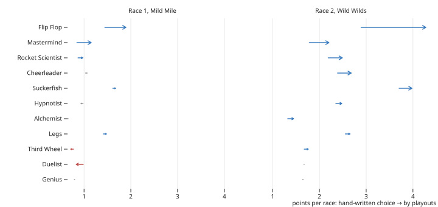

**On the Mild Mile the rules of thumb are close to the best.** The exceptions are Flip Flop, whose
best swap depends on more than distance, and Mastermind, which does better still predicting from
this particular race than from each racer's chance of winning in general.

**On the Wild Wilds the track is what matters.** The first rules of thumb ignored the track, and
playouts beat them by up to 1.7 points a race. Those gaps are where the advice above came from:

- **Where you'll land:** choosing by landing space gained, on the Wild Wilds, Legs 1.95 → 2.54,
  Flip Flop 2.54 → 2.95, Rocket Scientist 2.03 → 2.24, Alchemist 1.23 → 1.35 and Cheerleader
  2.31 → 2.40, with the Mild Mile unchanged within ±0.02.
- **Stars at 15 spaces:** logging each decision against playouts showed Flip Flop's best swaps
  landing on stars, often backwards, and Rocket Scientist's worst doubles stopping just short of
  the finish. Fixing those cut the gaps from +1.40 to +0.50 for Flip Flop, +0.38 to +0.05 for
  Mastermind, and +0.26 to +0.12 for Rocket Scientist.

Suckerfish was tried with the landing rule too and kept as it was: it scored 2.95 against 3.75
for always riding, because a ride the −4 arrow sends back still passes the star on 13 again.

**What's left of Flip Flop's gap has no pattern.** On the Mild Mile, only 0.07 of its 0.5 a race
survives a recheck with 10 times the playouts (`node scripts/decisions.ts --racer "Flip Flop"
--race 1`), so most of the gap is noise: pick the best of several noisy estimates and you'll
overrate it. On the Wild Wilds, 0.39 survives, spread over picking a different racer ahead,
swapping backwards near the star on 13 instead of rolling, and swapping with Copycat. Only the
Copycat swap made a rule. Cheerleader's gap is the same story: most of it doesn't survive a
recheck, and what does is scattered.

Not covered: Magician's rerolls and the picks made before a race (Egg, Twin).

## Racers that pick racers

Four racers borrow other racers' powers:

- **Egg** ("You should see the chicken") draws 3 racers before its race and keeps one's power.
- **Twin** picks the winner of an earlier race and races with its power.
- **Copycat** ("Very similar to another, different cat") has the power of whoever's leading.
- **Mastermind** predicts the winner.

How well they do depends on how they choose. *From `node scripts/twin.ts`*, which reruns them
choosing by each racer's points in that exact race, and gives Twin earlier winners drawn from the
earlier races. Points per race, 100,000 races of 5, against the dataset, where they choose by the
simulator's built-in ratings (each racer's points on that track at that table size; for
Mastermind, its chance of 1st). In the dataset, Twin is also averaged over both races on each
track:

| racer | race 1 | race 2 | race 3 | race 4 |
| --- | --- | --- | --- | --- |
| Twin | 0.90 → 0.28 | 3.64 → 2.96 | 1.24 → 2.10 | 4.16 → 4.87 |
| Egg | 1.65 → 1.67 | 3.29 → 3.42 | 2.11 → 2.11 | 3.74 → 4.00 |
| Mastermind | 1.05 → 1.06 | 2.14 → 2.15 | 1.55 → 1.51 | 2.64 → 2.64 |
| Copycat | 1.35 → 1.34 | 3.37 → 3.30 | 1.88 → 1.89 | 3.88 → 3.92 |

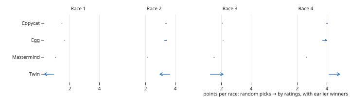

**Twin ("Not related to anyone, just identical to everyone") is a closer.** In race 4 it's the
second best racer of all, behind only Scoocher. With three earlier winners to choose from, it can
usually copy a strong one, often Scoocher, which wins half the races it's in. In race 1 it has
nothing to copy and is nearly worthless.

**Choosing by each race's own ratings adds little** over the built-in ones: −0.07 to +0.25 points
for Egg, Mastermind and Copycat, mostly in race 4. Choosing by any rating at all, rather than at
random, was worth half a point to a point a race to Egg and Mastermind. The rest of the ranking
hardly moves (rank correlation 0.95–1.00); what moves is mostly Twin.

## Whole games

*From `node scripts/games.ts`*, 100,000 games of 5 where everyone drafts the highest-rated racer
left and plays each team in its best race order.

| first-round pick | score | wins |
| --- | --- | --- |
| 1 | 11.07 | 27.1% |
| 2 | 11.47 | 30.0% |
| 3 | 9.68 | 16.8% |
| 4 | 8.89 | 13.8% |
| 5 | 8.36 | 12.4% |

**Your seat in the draft decides a lot.** Only 10 racers are flipped up per round at 5 players,
and the value is concentrated in a few of them, Scoocher above all, so the first picks take most
of it. The 2nd seat does best of all: the second snake draft starts one seat to the left, so it
picks first that round while the first player picks second. Between them, the first two seats win
57% of games, against 40% for an even share. That's decided by a roll-off, so it's the game's
biggest swing that isn't on the track.

**A stronger team wins, loosely.** The team with the best estimated value wins 42.4% of games,
against 20% for an even share, and the estimate correlates 0.45 with the final score. Estimates
run low (9.34 against 9.90 actual), probably because they come from races against random
opponents rather than drafted, stronger ones.

## Two racers each

*From `node scripts/games.ts --double --players 2` (or 3).* The rulebook's variants for 2 and 3
players have everyone draft 8 racers and race two at a time. 100,000 games each, with standard
games for comparison:

| game | 1st pick wins | 2nd pick | 3rd pick | best estimated team wins |
| --- | --- | --- | --- | --- |
| 2 players, two racers each | 50.5% | 49.5% | | 57.0% |
| 3 players, two racers each | 40.9% | 30.3% | 28.8% | 57.9% |
| 3 players, standard | 34.5% | 34.6% | 30.9% | 35.9% |
| 5 players, standard | 27.1% | 30.0% | 16.8% (then 13.8%, 12.4%) | 42.4% |

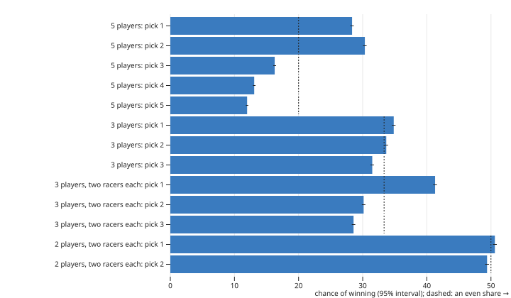

**The 2-player variant's draft is fair.** It picks ABBAABBA, then reverses for the second draft,
which cancels the first pick's edge.

**The 3-player variant's draft isn't.** It runs four snake drafts of 6, rotating who starts, so
the first player starts two of the four and wins 40.9% of games against 33.3% for an even share.
A table could fix it by giving the last pick of the first draft the first pick of the fourth.

**Standard drafts are fair at 3 players but not at 5,** where only the first two players ever
start a round.

**Team quality matters more with two racers each.** The best estimated team wins 57% of the time
in the variants, against 36% in standard 3-player games, where one racer per race leaves more to
luck.

## Does clever drafting pay?

*From `node scripts/draft.ts`*, which gives one randomly seated player a different drafting
strategy against opponents who take the highest-rated racer left (100,000 games of 5 each):

| my draft | wins | score |
| --- | --- | --- |
| highest rating, as opponents do | 20.2% | 9.93 |
| most added to my best race order | 19.8% | 9.91 |
| my gain plus the most it would add to an opponent (denial) | 19.8% | 9.90 |

**No. Take the best racer.** Both alternatives score within 0.03 points a game of taking the
highest rating, and win 0.4 percentage points less often: about the size of the noise over
100,000 games, and invisible at a table. The value is concentrated in a few racers, so the racer
that adds most to your team, the one that would add most to an opponent's, and the best one are
nearly always the same pick. Where you sit in the draft matters far more than how you draft.

## Choosing racers during the game

*From `node scripts/endgame.ts`*, which lets one randomly seated player choose its racer before
each race differently from the opponents, who play their best race order (100,000 games of 5
each):

| my choices | wins | score | my M.O.U.T.H. met their Scoocher | wins in those games |
| --- | --- | --- | --- | --- |
| best race order, as opponents do | 19.9% | 9.89 | 0.6% of games | 14.8% |
| by score: with two left, save the safe one when ahead, the likely winner when behind | 19.7% | 9.83 | | |
| counter: draft M.O.U.T.H. once an opponent has Scoocher, and race it in Scoocher's race | 19.6% | 9.68 | 4.4% of games | 9.0% |

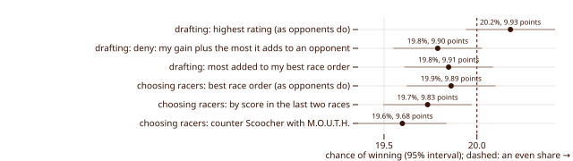

**Just play your best race order.** Switching by score gives up 0.06 points a game, and the
racers' spreads are too alike for the safe pick or the long shot to make it back.

**Countering Scoocher doesn't pay for the one doing it.** When your M.O.U.T.H. meets their
Scoocher you win only 9.0% of the time. Slowing or eating Scoocher helps the other three
opponents as much as you, while it costs you a better draft pick and M.O.U.T.H.'s own best race.

## Safe racers and swingy ones

*From `node scripts/spread.ts`.* An average hides how a racer gets there: some score a little
every time, others all or nothing. Race 4 on the Wild Wilds (5/4), selected; sd is the standard
deviation, how far a typical race strays from the mean:

| racer | mean | sd | 0 points | at least gold |
| --- | --- | --- | --- | --- |
| Scoocher | 8.36 | 4.93 | 1% | 85% |
| Suckerfish | 4.60 | 3.85 | 14% | 53% |
| Dicemonger | 4.51 | 2.44 | 2% | 53% |
| Flip Flop | 4.34 | 2.65 | 8% | 57% |
| Copycat | 3.88 | 3.49 | 20% | 45% |
| Lovable Loser | 3.85 | 2.75 | 12% | 39% |
| Sisyphus | 3.76 | 1.56 | 2% | 26% |
| Romantic | 3.57 | 2.35 | 20% | 52% |
| Heckler | 3.54 | 2.37 | 21% | 51% |
| Mastermind | 2.64 | 2.19 | 27% | 25% |

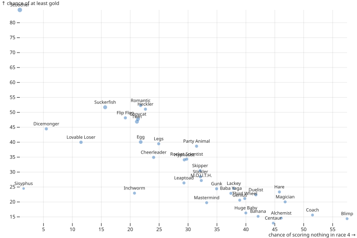

**Protecting a lead in race 4,** pick a racer that rarely scores nothing. Sisyphus ("Stays humble,
keeps grinding"), at 2%, is the steadiest of all, and Dicemonger (2%) and Flip Flop (8%) are
nearly as sure of a few points.

**Catching up in race 4,** pick a racer that often scores gold or more. Flip Flop (57%),
Suckerfish and Dicemonger (53%) do it more than half the time, against Sisyphus's 26%. Dicemonger
and Flip Flop are both safe and likely to win. Scoocher is the safest and the likeliest to win,
so it's the best racer whichever position you're in.

## Going first

*From `node scripts/seats.ts`.* Points by seat in turn order, seat 1 going first:

| players | seat 1 | seat 2 | seat 3 | seat 4 | seat 5 | seat 6 | seat 1 − average |
| --- | --- | --- | --- | --- | --- | --- | --- |
| 3 | 2.00 | 1.88 | 1.75 | | | | +0.12 |
| 4 | 1.57 | 1.48 | 1.38 | 1.32 | | | +0.13 |
| 5 | 1.29 | 1.22 | 1.16 | 1.11 | 1.08 | | +0.12 |
| 6 | 1.08 | 1.04 | 0.99 | 0.96 | 0.94 | 0.92 | +0.09 |

That's race 1 on the Mild Mile; the Wild Wilds is a little flatter (+0.07 to +0.11).

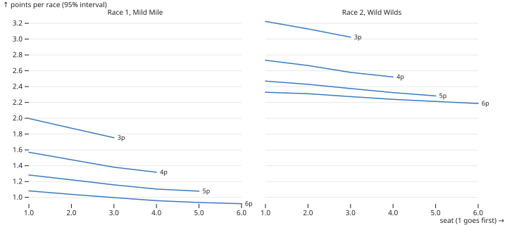

**Going first is worth about 0.1 points a race,** roughly 10% above an average seat, and each
later seat is worth a little less. With 5 players, seat 1 earns 19% more than seat 5. After the
first race, the player whose racer finished farthest behind goes first, so that rule is a small
catch-up, far smaller than a strong racer is worth.

## More findings

**Romantic ("The last of her species") is strong, but less so under the 2026 printing.** The new
printing says powers about stopping together don't trigger for racers that arrive at the same
time, as when Suckerfish rides along or Party Animal pulls everyone in. That took Romantic's Mild
Mile wins from 61% to 54%.

**Suckerfish declining a ride doesn't pay for Suckerfish.** Staying put near the finish rather
than riding another player's Scoocher home raises Suckerfish's wins from 3% to 19%, but its
points stay the same in race 1 (1.74) and drop in race 4 (3.45 to 3.29), since gold beats silver
by only 1 point. It's kept because it costs Scoocher's owner a lot. (Measured under the 2025
printing.)

**The Wild Wilds has a loop.** The arrow on 16 sends racers back to 12, so anything moving 1
space at a time circles 12–16 and crosses the star on 13 each lap. Scoocher averages 5.04 bronze
a race there. With Suckerfish along, the pair would farm about 21 a race, except that the box
only holds 43 points of bronze chips for the whole game. So in full games the pair also starves
everyone else's stars.

**The Duelist should always duel.** Duelist ("When you've got a rapier, everything looks like a
duel") can challenge any racer on its space; both roll, and the higher roll moves 2, with ties
going to the Duelist. It wins 58% of duels, and every alternative scored lower (race-1 points
over 200,000 races, on an earlier version of the simulator):

- always duel: 0.99;
- decline when losing would carry the other racer across the line: 0.88;
- also decline late in the race: 0.76;
- never duel: 0.32.

## Against real play and another simulator

What players report on BoardGameGeek agrees with the model on the main points:

- **Scoocher is the strongest racer, more so at bigger tables.** In
  ["Is Scoocher OP?"](https://boardgamegeek.com/thread/3635824), players describe it running away
  with races and "worse with higher player counts", but beatable with Hypnotist or Flip Flop
  around. One player names Mastermind, Centaur and Third Wheel as "really quite bad" and Scoocher,
  Gunk and Suckerfish as "game-warpingly good."
- **The Wild Wilds star farm happens at real tables.** In the same thread, a Scoocher stuck
  around the −4 arrow kept scooching onto the star and "amassed a whopping 14 points."
- **The spread is deliberate.** Richard Garfield, in that thread: "the intent was to keep a pretty
  big spread in power … Balanced for boredom, not power."

An independent simulator, [MagSim](https://github.com/pschonev/magsim) by Philipp Schoneville
([thread](https://boardgamegeek.com/thread/3673716)), reaches the same ranking: Scoocher far
ahead, then Romantic, Lovable Loser and Sisyphus; Heckler, Flip Flop and Legs strong; Blimp,
Banana and Alchemist weak; and Twin the best of the racers that copy. Its author also found a
Scoocher–Copycat loop on the Mild Mile that wins on the first turn, which MagSim leaves out of its
data. MagSim reads some rules differently, so the two agreeing is evidence the ranking doesn't
hinge on our readings.

**Per racer, the two simulators agree closely.** MagSim publishes its dataset (about 8,000
5-player races per track). Comparing each racer's chance of 1st at 5 players with ours (200,000
races per track, on an earlier version of the simulator):

| | rank correlation | within 3 points | biggest differences |
| --- | --- | --- | --- |
| Mild Mile | 0.85 | 30 of 36 racers | Twin −36.9, Copycat +13.3, Flip Flop −7.0, Suckerfish +6.8 |
| Wild Wilds | 0.87 | 29 of 36 racers | Twin −27.1, Copycat +12.7, Legs −5.3, Suckerfish +5.0 |

Scoocher matches almost exactly (64.8% against 64.0% on the Mild Mile). With about 1,100 races
per racer in MagSim's data, differences of 3 percentage points are within its noise. The large
ones have explanations:

- **Twin:** MagSim always gives it three earlier winners to copy; the version compared here gave
  it none.
- **Copycat:** MagSim's data has no Mild Mile races with both Copycat and Scoocher (about 130
  expected) and only 68 on the Wild Wilds, because it drops the Scoocher–Copycat first-turn loop.
  Copycat does very well alongside Scoocher, so leaving those races out lowers its numbers.
- **Suckerfish and Flip Flop:** each plays its optional power by a different rule in the two
  simulators.

Not done: comparing with logged real games.

## Rules questions

Some rules are still open to interpretation. *From `node scripts/sensitivity.ts`*, which reruns
races 1 and 2 (100,000 races of 5 each) with each open reading flipped. Neither matters beyond its
own racer:

| reading | race 1 | race 2 |
| --- | --- | --- |
| main moves pushed below 0 go backwards (Hague yes, Garfield no) | under 0.1 for everyone | under 0.1 for everyone |
| triggers queue and resolve even if the board changed (Garfield's own play) | Romantic +0.11 (of 2.03) | Romantic +0.12 (of 2.91) |

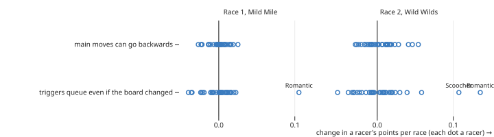

Queuing lets a Romantic move even after the pair it saw has broken up. The simulator instead
re-checks each trigger as it resolves.

Two more were settled rather than left open:

- Duelist duels everyone on the Start before the first turn, worth about 0.15 points a race to it.
- Blimp's second corner is space 15, where the track turns the second time. Counting the Start's
  rounded end as the first corner would make it 12 and cost Blimp about 0.2 points a race.

### Rules findings

- The 2025 printing's note under Sisyphus, "I still get my main move after warping", was a
  misprint; the 2026 printing says "I don't get my main move after warping."
- Some races can't end, like four racers on space 29 with Coach (+1 to everyone on its space) and
  Stickler ("Proofread this rulebook without asking"; others can only finish with an exact roll).
  The 2026 printing ends such a race with no further points.
- A Copycat ping-pongs forever with Hypnotist or Flip Flop if they keep targeting each other.
  Hypnotist avoids it. Flip Flop doesn't, since it pays: other racers usually finish while the two
  trade places. When they're the last two left, it's a loop no one can finish, which ends the race
  with no more points (fiddly details 5 in the rulebook). The simulator used to end those only
  after 1,000 turns, letting the pair farm stars until then.
- Huge Baby on 12 traps a racer between 11's arrow (+1) and 16's (−4). The loop rule ends it after
  one pass.
- Flip Flop can swap with a racer on its own space, but neither scores the space again: a warp
  that doesn't change spaces triggers nothing (Garfield and Hague,
  [BGG](https://boardgamegeek.com/thread/3584489/article/46674967)). The simulator used to score
  the star again, which the playouts found and farmed.

## Next

`TODO.md` has what's left: logging real games and comparing them with the model.
